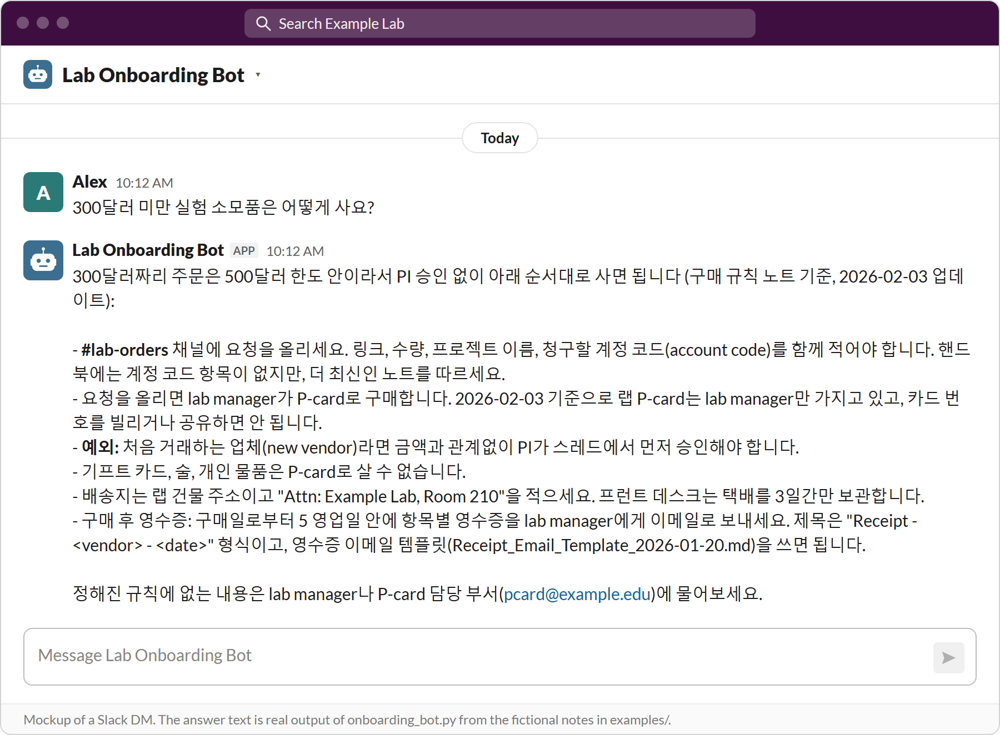
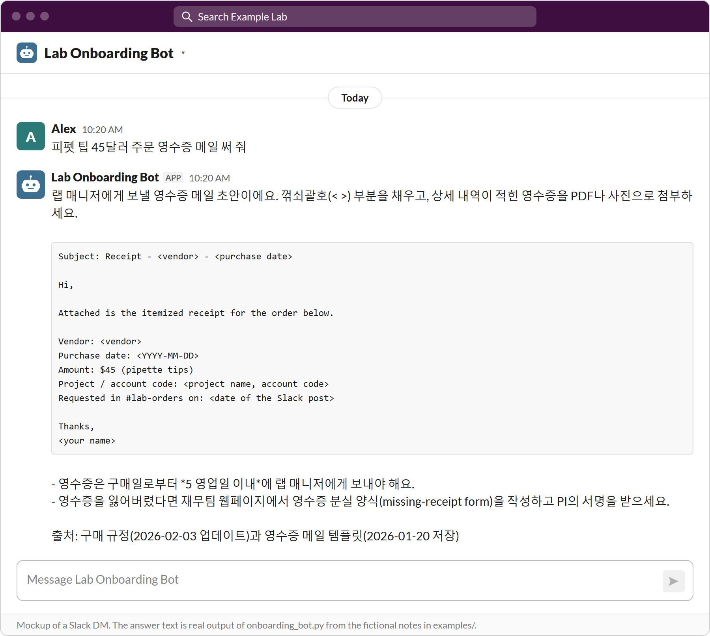
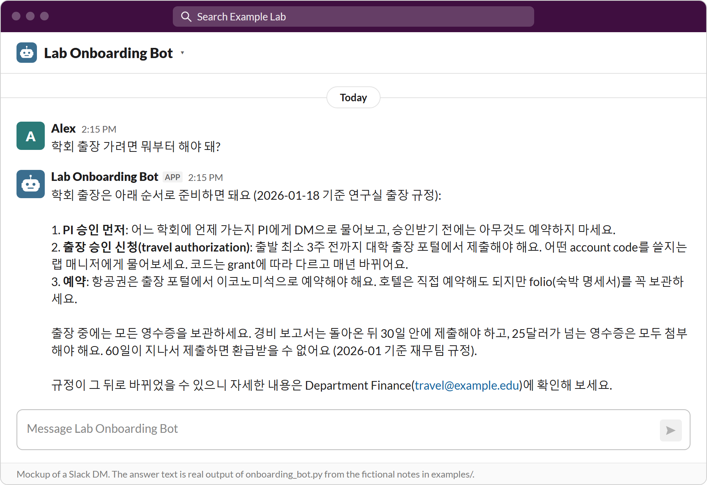
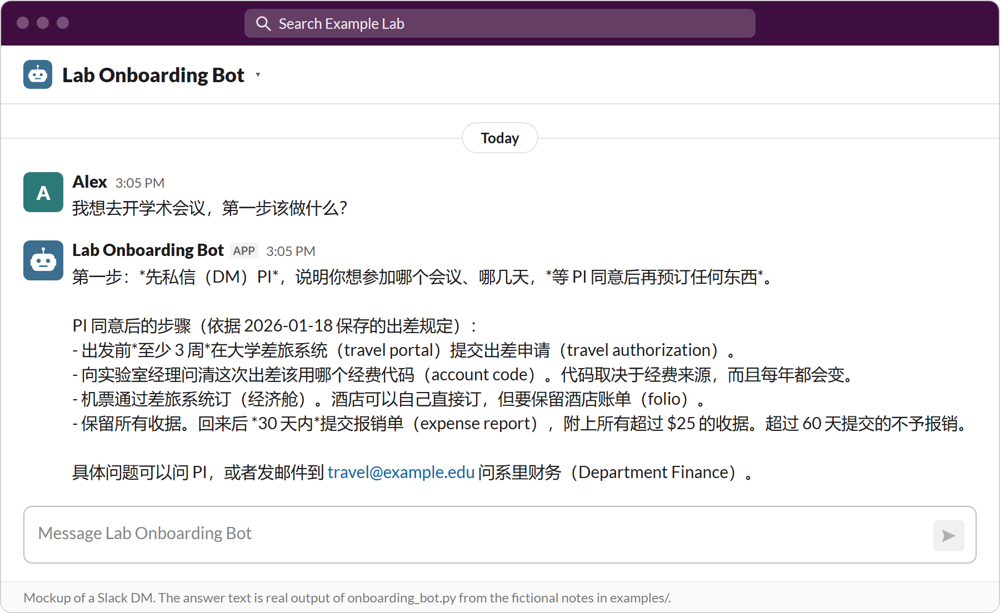
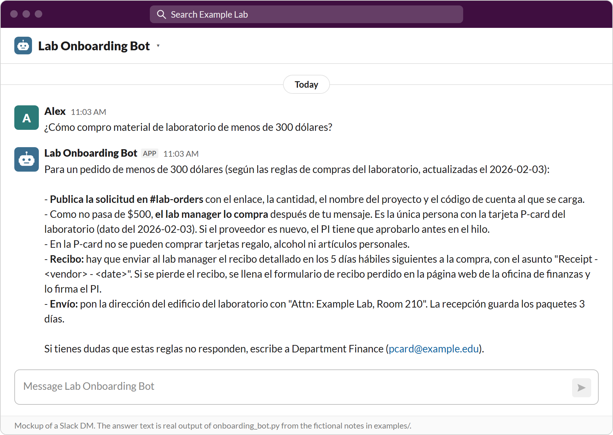
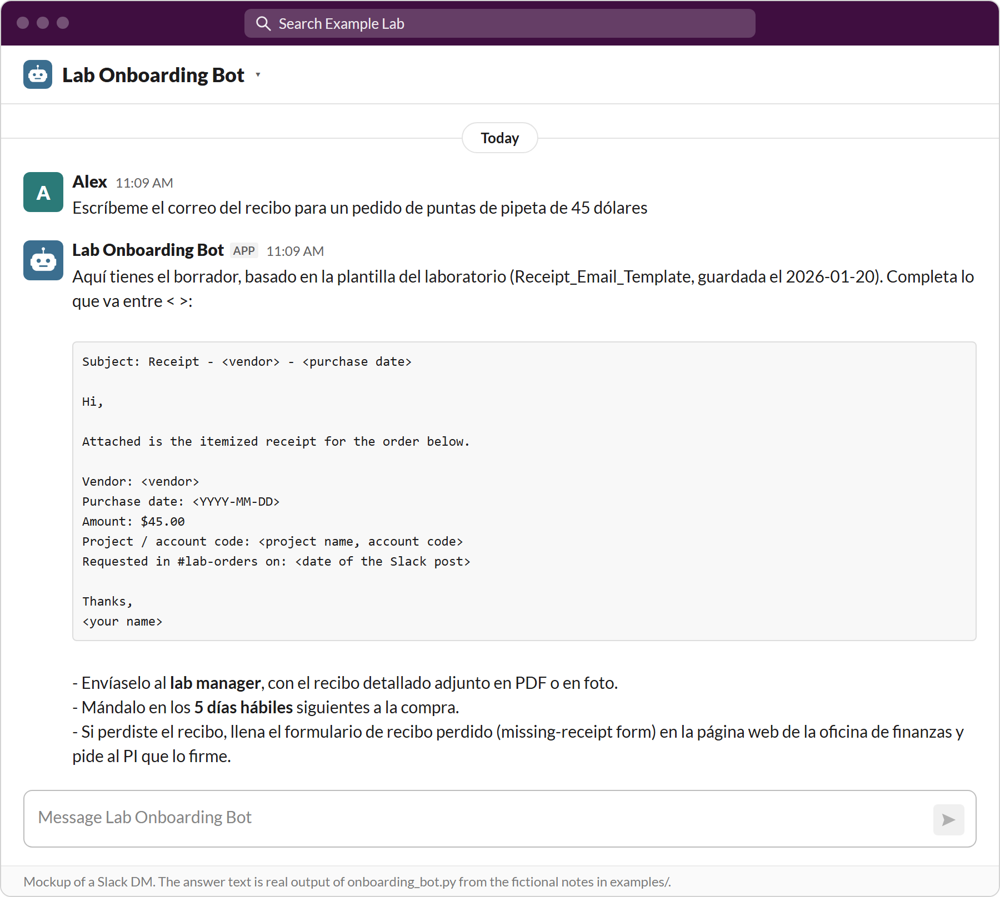
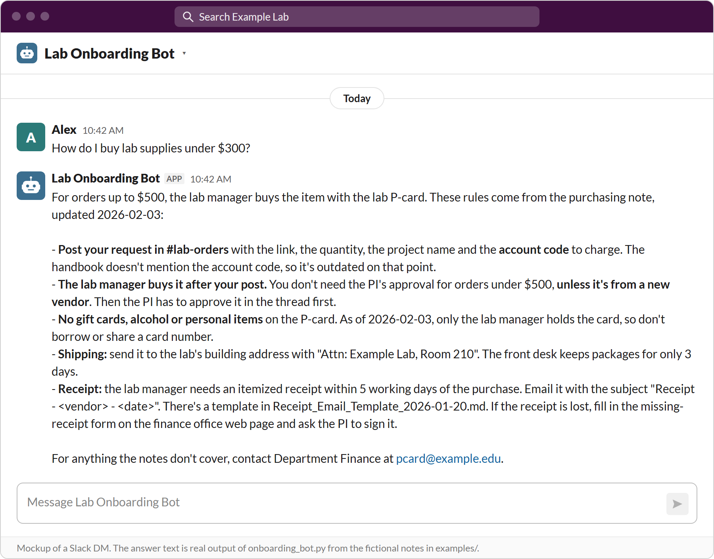
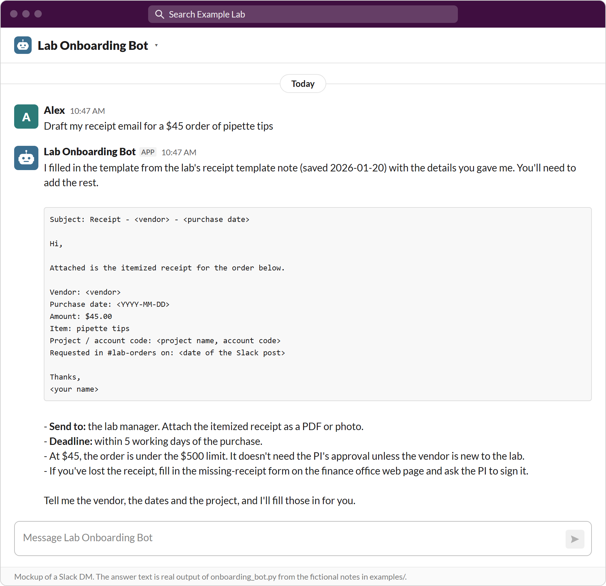
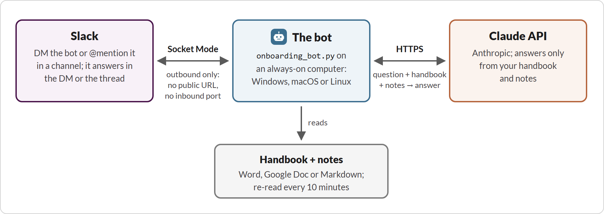

# Lab Onboarding Bot for Slack

A Slack bot that answers new lab members' questions ("How do I order something?", "Where do I send my receipt?",
"How much vacation do I get?") from your **lab handbook** and a folder of **reference notes**, using Claude. It
runs on any always-on computer in the lab (Windows, macOS or Linux), needs no server, no public URL and no inbound
port, and keeps nothing about conversations on disk.

> [!IMPORTANT]
> **Slack only.** The bot works only with Slack: it is a Slack app that connects to Slack in Socket Mode. There is no
> version for Microsoft Teams, Discord, email or the web.
>
> **You need** a Slack workspace where you can install an app (or a workspace admin who approves it), an Anthropic
> API key and a computer that stays on.

This repository is a working, tested bot with fictional example content for "Example Lab". Replace the examples with
your own handbook and notes, set a few variables, and it is your lab's bot.

## What it looks like

Mockups of a Slack DM with the bot, in four languages. The Slack window, the person asking (Alex) and the times are
made up; the answer text is real, unedited output of `onboarding_bot.py` answering from the fictional handbook and
notes in `examples/`.

<details open>
<summary><b>한국어</b></summary>

봇은 질문한 언어로 답합니다.

실험 소모품 구매 방법을 물으면 예시 구매 노트대로 답합니다:



복사해서 보낼 초안(여기서는 영수증 메일)은 코드 블록에 담아 줍니다:



학회 출장은 무엇부터 해야 하는지 순서대로 안내합니다:



</details>

<details>
<summary><b>中文</b></summary>

用什么语言提问，机器人就用什么语言回答。

问去开学术会议第一步做什么，机器人按示例出差规定说明步骤：



</details>

<details>
<summary><b>Español</b></summary>

El bot responde en el idioma en que se le pregunta.

Para comprar material de laboratorio, responde con las reglas de la nota de compras de ejemplo:



Los borradores para copiar y enviar (aquí, el correo del recibo) van en un bloque de código:



</details>

<details>
<summary><b>English</b></summary>

The bot answers in the language it is asked in.

A purchasing question, answered from the example purchasing note:



Drafts to copy and send (here a receipt email) come in a plain code block:



</details>

With the example settings, `tools/test_live.py` asks questions like these from the terminal (no Slack needed); live
answers vary a little from run to run.

## What it does

- **Answers in Slack**: in a DM with the bot, or when someone writes `@Lab Onboarding Bot <question>` in a channel
  (answered in a thread). A `typing...` placeholder appears at once and turns into the answer a few seconds later.
- **Answers only from your documents**: the handbook plus every note file goes into the (cached) system prompt. When
  the documents do not cover a question, the bot says so and names who to ask (`LAB_CONTACT`). Notes are treated as
  newer than the handbook, and the newest dated rule wins.
- **Live handbook**: point `DOC_URL` at a Google Doc ("anyone with the link can view") and edits go live within 10
  minutes; pending suggestions are shown to the model as "not yet approved". Or use a local `.docx`, `.md` or `.txt`.
- **Notes folders** (`KNOWLEDGE_DIRS`): Markdown/text files with lab rules, Slack posts, email templates and dated
  copies of university web pages, re-read every 10 minutes.
- **Conversation memory**: follow-up questions work. The bot reads the earlier messages back from Slack for each
  question (DM history, or the current thread); nothing is stored on the computer. `reset` / `new chat` starts over.
- **Learning**: people can tell the bot lasting facts. Lab facts from `TEACHERS` are saved at once to
  `_Learned/Learned_from_Slack.md`; facts from anyone else go to the approver (the first teacher) as a Slack DM
  (`approve` / `reject` in the thread). Personal facts ("I start on May 3") are kept in a message pinned in that
  person's DM, and "forget me" deletes them. Posts in `LEARN_CHANNELS` (e.g. #general) are learned the same way.
  Passwords, codes, card numbers and other people's personal details are never saved without the approver's look.
- **Files**: images and PDFs attached to a question are read (in memory only).
- **Guards**: per-user hourly question limit, file-size budget, `<!channel>` pings defused, optional outage alerts via
  healthchecks.io, `LEARNING=off` / `FILES=off` kill switches.

## Architecture



In more detail:

```
 Slack workspace                           lab computer (always on)                           Anthropic API
 ---------------                           ------------------------                           -------------
 DM / @mention  --- Socket Mode (outbound  onboarding_bot.py  (slack_bolt, one process)
                    websocket, no inbound  - handbook: DOC_URL (Google Doc, Word export) or HANDBOOK_FILE
                    port) --------------->  - notes:    KNOWLEDGE_DIRS/*.md|*.txt (re-read every 10 min)
                                           - memory:   earlier messages read back from Slack per question
 answer (edited <------------------------  - system prompt = rules + handbook + notes (prompt-cached)  ---> claude-opus-5-5
 placeholder)                              - tools the model may call: remember, forget                     (answers)
 approval DMs,  <------------------------  - _Learned/Learned_from_Slack.md (lab facts it learned)   ---> claude-haiku-5-5
 pinned profiles                           - bot.log (counts only, never message text or names)            (classifies)
```

- One Python file, `onboarding_bot.py` (about 2,200 lines, heavily commented). Three direct dependencies:
  `slack_bolt`, `anthropic`, `python-docx`.
- Model: `claude-opus-5-5` with effort `low` and server-side fallback for safety-classifier declines;
  `claude-haiku-5-5` sorts "remember" messages and channel posts and double-checks deletion requests.
  Change `MODEL` / `CLASSIFIER` at the top of the file.
- Every question sends the whole handbook and all notes (no retrieval step). With prompt caching this is simple and
  accurate, and it stays affordable up to a few hundred thousand tokens (see *Cost*).

## Repository layout

```
onboarding_bot.py            the bot
requirements.txt             exact package versions (tested with Python 3.12.9, see .python-version)
.env.example                 every setting, with placeholders; copy it to ~/.onboarding_bot.env
slack-app-manifest.json      creates the Slack app with the right scopes and events
bot_icon.png                 a generic app icon (upload in the Slack app settings)
usage_report.py              cost per day from Anthropic's Admin API (optional)
examples/handbook.md         a fictional handbook
examples/notes/              fictional reference notes (purchasing, travel, a receipt email template)
examples/_Learned/           where learned lab facts go (the folder name _Learned matters)
scripts/                     autostart: Windows Task Scheduler, macOS launchd, Linux systemd
tools/                       offline and live tests, the notes checker, token counter, web-page snapshotter
docs/images/                 the pictures in this README (Slack DM mockups, architecture diagram)
```

## Step by step, from zero

You need: a Slack workspace where you may install apps, an Anthropic API account
([platform.claude.com](https://platform.claude.com)) with credit, and a computer that stays on and online (outbound
HTTPS to `slack.com`, `wss-primary.slack.com` and `api.anthropic.com` only).

### 1. Create the Slack app from the manifest

1. Go to <https://api.slack.com/apps> > **Create New App** > **From a manifest**, pick your workspace, choose JSON
   and paste `slack-app-manifest.json`. Create it. (Rename the app there if you like.)
2. **Basic Information** > **App-Level Tokens** > **Generate Token and Scopes**: any name, scope `connections:write`.
   Copy the token (`xapp-...`): this is `SLACK_APP_TOKEN`.
3. **Install App** > **Install to Workspace** > Allow. Copy the **Bot User OAuth Token** (`xoxb-...`): this is
   `SLACK_BOT_TOKEN`.
4. Optional: **Basic Information** > **Display Information** > upload `bot_icon.png`.

What the manifest asks for, and why:

| Scope / event | Used for |
|---|---|
| `app_mentions:read`, event `app_mention` | questions in channels (`@bot ...`) |
| `chat:write` | answering, editing the placeholder, approval DMs, deleting its own messages on request |
| `im:history`, `im:read`, event `message.im` | DMs: questions, approvals, and the DM conversation memory |
| `channels:history`, `groups:history`, `mpim:history` | memory in channel / private-channel / group-DM threads; channel learning |
| `channels:read`, `groups:read`, `mpim:read` | telling a public channel from a private one (private names never go into notes) |
| event `message.channels` | learning from posts in `LEARN_CHANNELS` (a private learned channel would also need `message.groups`) |
| `files:read` | reading images and PDFs attached to questions |
| `pins:read`, `pins:write` | personal profiles (a pinned message in each person's DM) |

At startup the bot checks its granted scopes and logs which features are on; a missing scope turns that feature off
instead of failing. The history scopes let the token read whole channels the bot is in, although the code reads only
threads it is mentioned in and posts in `LEARN_CHANNELS`: keep the bot out of sensitive channels.

### 2. Get an Anthropic API key

[platform.claude.com](https://platform.claude.com) > Settings > API keys > Create key (`sk-ant-...`). Recommended:
create a separate workspace for the bot and set a monthly spend limit on it. If your key is a personal key that
spans several workspaces, also set `ANTHROPIC_WORKSPACE_ID`.

### 3. Get the code

```bash
git clone <your copy of this repository> lab-onboarding-bot
cd lab-onboarding-bot
```

Keep it on a local disk (not a network share that may not be mounted at boot).

### 4. Create the virtual environment and install the exact versions

Use Python 3.12.9 (`.python-version`; with pyenv: `pyenv install 3.12.9`). Python 3.10+ works, but only 3.12.9 with
`requirements.txt` is the tested combination.

```bash
# macOS / Linux
python3.12 -m venv .venv
.venv/bin/python -m pip install -r requirements.txt
```

```powershell
# Windows (PowerShell)
py -3.12 -m venv .venv
.venv\Scripts\python -m pip install -r requirements.txt
```

### 5. Write the settings file (outside the repository)

```bash
cp .env.example ~/.onboarding_bot.env && chmod 600 ~/.onboarding_bot.env      # macOS / Linux
copy .env.example %USERPROFILE%\.onboarding_bot.env                           # Windows (cmd)
```

Edit it: put in the three secrets, your lab's name and contacts, and the handbook and notes locations. Every setting
is explained in `.env.example`. The file lives in your home folder so it can never be committed; to keep it elsewhere
set the environment variable `ONBOARDING_BOT_ENV` to its path. Real environment variables win over the file.

Lab settings and their generic defaults:

| Variable | Default | Used in |
|---|---|---|
| `LAB_NAME` | `Example Lab` | "You are the Example Lab onboarding assistant", classifier prompts |
| `LAB_DESCRIPTION` | `university research lab` | classifier prompts |
| `LAB_CONTACT` | `the PI` | who to ask when the documents do not cover a question; the refusal reply |
| `INSTITUTION`, `DEPARTMENT` | `university`, `department` | "university-wide rules are the baseline; lab and department rules add to them" |
| `FINANCE_NAME`, `FINANCE_CONTACTS` | `Department Finance`, none | who confirms P-card and travel rules (e.g. `travel@... for travel, pcard@... for P-cards`) |
| `ACCOUNT_CODES` | `account codes` | your institution's word for the codes purchases and trips are charged to |
| `CHARGE_CODE_WORD` | `project` | the word before "code" in a charge code ("project code 12345678"), so the secret check lets it through |
| `REFUSED` | built from the two above | the reply when every model declines |
| `TEACHERS` | none | `<member ID>:<name>,...`; the first one approves everyone else's lab facts |
| `MAINTAINER` | `the lab admin` | named in answers about problems with the bot itself |
| `LEARN_CHANNELS` | none | channel IDs whose posts the bot learns from |
| `MEMORY_SINCE` | `0` | Unix time; DM memory never reaches back before it |
| `HANDBOOK_FILE` / `DOC_URL` | `onboarding.docx` / none | the handbook (see `.env.example`) |
| `KNOWLEDGE_DIRS` | none | note folders, `;` between them on Windows, `:` on macOS/Linux |
| `LEARNING`, `FILES` | `on` | kill switches |
| `HEALTHCHECK_URL` | none | outage alerts (step 8) |

A Slack member ID: click the person's name > View full profile > three dots > Copy member ID. A channel ID: open
the channel name > the ID is at the bottom of the About tab.

### 6. Put your handbook and notes in place

- Handbook: set `DOC_URL` to a Google Doc share link (General access: "Anyone with the link", Viewer), or
  `HANDBOOK_FILE` to a `.docx`, `.md` or `.txt` file. Text from a paragraph `Signatures:` onward is dropped (DocuSign
  audit pages carry emails and IP addresses).
- Notes: start with a copy of `examples/notes` and `examples/_Learned` in a private folder (e.g. `notes/`, which is
  git-ignored, or a synced drive folder that is kept available offline), then point `KNOWLEDGE_DIRS` at them. Keep your
  real notes **out of this repository** if it is public or shared.
- To try everything first, keep the example values from `.env.example`.

### 7. Run it

First a terminal test without Slack (one real Claude call):

```bash
.venv/bin/python onboarding_bot.py "How much vacation time do I get?"        # macOS / Linux
.venv\Scripts\python onboarding_bot.py "How much vacation time do I get?"    # Windows
```

Expect `[Document loaded] ...`, `[Notes loaded] 4 files, ...` and a short answer (15 working days with the example
handbook). Then start the Slack bot:

```bash
.venv/bin/python -u onboarding_bot.py
```

The log shows which features are on, then `Bolt app is running!`. DM the bot a question; mention it in a channel after
`/invite @Lab Onboarding Bot`. Only one instance may run at a time, or every question is answered twice.

### 8. Keep it running

- **Windows** (no admin rights needed): `powershell -ExecutionPolicy Bypass -File scripts\install_windows_task.ps1`.
  It registers a Task Scheduler task that starts `pythonw.exe` from the venv at logon (no console window; the log goes
  to `bot.log`), restarts it every minute after a crash, has no run-time limit, and re-checks every 5 minutes. To have
  it come back after a reboot without anyone logging on, run `scripts\enable_no_login.ps1` once (it asks for your
  Windows password, which Task Scheduler stores encrypted). Keep the PC from sleeping.
- **macOS**: edit the paths in `scripts/com.example.lab-onboarding-bot.plist`, copy it to `~/Library/LaunchAgents/`
  and `launchctl bootstrap gui/$(id -u) ~/Library/LaunchAgents/com.example.lab-onboarding-bot.plist`.
- **Linux**: `scripts/lab-onboarding-bot.service` as a systemd user service (instructions inside).
- **Outage alerts** (recommended): create a check at [healthchecks.io](https://healthchecks.io) (period 5 min, grace
  5 min), put its ping URL in `HEALTHCHECK_URL`, restart. The bot pings every minute while connected to Slack and
  pings `/fail` when a Claude call fails, so you get an email when the computer, the network or the bot is down.

After changing the settings file or the code, restart the bot (notes and a `DOC_URL` handbook need no restart).

## The knowledge notes workflow

The bot is only as good as its notes. Treat them like code: stage, check, review, deploy.

**What makes a good note**

- One topic per file, plain Markdown, a date in the file name (when it was first saved) and an `Updated YYYY-MM-DD`
  line when it changes. Every fact has a date and a source ("PI in #lab-orders, 2026-01-14"); things that change get
  "as of".
- Copy rules from Slack posts, emails and meetings as short statements, not chat logs. Email or message drafts people
  should copy go in a plain ` ``` ` code block (the bot keeps them that way). See `examples/notes/`.
- Public web pages (university finance and travel rules): `tools/snap.py OUT.md URL ...` saves a dated Markdown copy
  with the source link, which the bot cites.
- Where a note overrides the handbook, say so; the bot is told that notes win over the handbook and newer rules win.
- Only `.md` and `.txt` files directly inside each folder are read (subfolders are not: keep sources in `sources/`).
  Files are re-read every 10 minutes.

**Privacy rules** (decide them with your PI before the first note goes live)

- Never put in: passwords, door / printer / lockbox / Wi-Fi codes, API keys, admin logins, card or account numbers,
  personal phone numbers, home addresses, anyone's visa, health, financial or family situation, performance or job
  search. Where people need such a thing, write who to ask instead ("the printer code: ask the lab manager").
- Content from DMs and private channels goes in only as rule summaries ("lab tip"), without the names of the people in
  the conversation, and only with the owner's consent for that sync.
- A credential goes in only if the owner says yes to that exact item; record the approval in
  `tools/secret_allowlist.txt` (a hash of the line and the reason, never the value).
- Check your institution's policy on using AI tools with internal data before adding non-public material.
- Every question sends all notes to the Anthropic API: write nothing there you would not send to it.

**Check before deploying**

```bash
.venv/bin/python -I -B -X utf8 tools/check_notes.py onboarding_bot.py notes/purchasing notes/travel notes/_Learned
```

It loads the folders with the bot's own loader and scans every line for secret-looking text, printing only file,
line and rule names. Exit code 0 is required. Fix each `FAIL`; for an approved exception, `--hash FILE:LINE` prints an
allowlist entry.

**Updating the notes from Slack (a repeatable sync)**

Lab rules mostly live in Slack posts. A sync every week or two keeps the bot current. It works well with an AI
coding agent that has a read-only Slack connector (e.g. Claude Code with the Slack connector), or by hand:

1. **Scope and period**: start from the date in your sync log (`tools/slack_sync_log.md`, git-ignored). Public
   channels need no extra consent; DMs and private channels need the owner's explicit yes for each sync.
2. **Search**: sweep every message since that date (Slack search `after:<day before>`, sorted oldest first), read the
   rule-heavy channels in full (general, orders, safety, trip channels, ...), then keyword searches as a net (pcard,
   receipt, reimburse, travel, per diem, training, safety, key, storage, VPN, printer, and the names of your admin
   staff). Never post, react or edit while syncing.
3. **Digest**: list each finding as NEW, UPDATE or COVERED (already in the notes), with channel, date and author.
   Apply the privacy rules here: leave out every secret and personal detail.
4. **Stage**: copy each notes folder twice, to `orig/<folder>` (untouched) and `kb/<folder>` (edit these, same folder
   names); write the changes into `kb` (the right topic file; new rule sets as a new dated file).
5. **Check**: run `tools/check_notes.py` on the `kb` folders until it exits 0.
6. **Review**: have a second person (or a separate review agent) read `diff -ru orig kb` against the privacy rules.
7. **Deploy**: confirm every live file still equals its `orig` copy (the bot may have added a learned fact meanwhile;
   merge it), copy only the changed files into the live folders, run the check on the live folders, and watch for
   `[Notes updated] N files` in `bot.log` within 10 minutes (a new folder needs `tools/add_knowledge_dir.py` and a
   restart). Optionally ask 2-4 questions with `tools/test_live.py`.
8. **Record**: add an entry (date, scope, files changed, what was left out) and the next start date to the sync log.

Learned facts: `_Learned/Learned_from_Slack.md` is written by the bot. You may edit or delete its lines (the bot
re-reads it), or move facts into topic files during a sync; keep its header.

## Cost

Each question sends the handbook and all notes. With prompt caching, the first question after a 5-minute pause pays
the cache write and later ones read the cache (prices of `claude-opus-5-5` as of 2026-11; check current pricing):

| Prompt size | Cold question (cache write, ~$5/M tokens) | Warm question within 5 min (~$0.20/M) |
|---|---|---|
| ~5k tokens (the examples) | ~$0.03 | under $0.01 |
| ~250k tokens (a handbook + ~20 notes, 1M-token context) | ~$1.3 | ~$0.06 |

Plus the answer (~$20/M output tokens, usually a few hundred tokens) and the conversation memory (at most
`HISTORY_TOKENS` = 50k tokens, about +$0.25 cold). "Remember" checks with Haiku cost about $0.001 each.

- Measure your prompt: `tools/count_tokens.py`; real spend: the Anthropic Console (or `usage_report.py` with an Admin
  key).
- Cheaper: `MODEL = "claude-sonnet-5-5"` (about half) or `"claude-haiku-5-5"` (much cheaper, less careful); remove large
  snapshot notes nobody needs.
- Backstops: `USER_LIMIT` (20 questions per person per hour) and a monthly spend limit on the bot's API workspace.

## Testing and reproducibility

```bash
# offline: 312 checks, no network, no keys needed, uses examples/ and fixed fictional settings
.venv/bin/python -I -B -X utf8 tools/test_offline.py
# the example notes pass the notes gate
HANDBOOK_FILE=examples/handbook.md .venv/bin/python -I -B -X utf8 tools/check_notes.py onboarding_bot.py examples/notes examples/_Learned
# live: real Claude calls with your settings, prints answers, tokens and cost
.venv/bin/python -X utf8 tools/test_live.py onboarding_bot.py
```

(Windows: `.venv\Scripts\python` and `set HANDBOOK_FILE=examples\handbook.md` first.)

To reproduce the tested setup exactly: Python **3.12.9** (`.python-version`), a fresh venv, `pip install -r
requirements.txt` (every package pinned, dependencies included), then `tools/test_offline.py` must print `ALL PASS`.
The model IDs are fixed in `onboarding_bot.py` (`MODEL`, `CLASSIFIER`); answers from a live model are not
byte-for-byte reproducible, but the prompts, tools and requests the bot sends are (the offline tests check them).

## Troubleshooting (short)

| Symptom | Fix |
|---|---|
| `Missing SLACK_BOT_TOKEN, ...` | The settings file is not where the bot looks (`~/.onboarding_bot.env`, or `ONBOARDING_BOT_ENV`) or values are empty |
| `Bolt app is running!` but no `[question]` lines | Event subscriptions or App Home messages tab missing: recreate from the manifest, reinstall, restart |
| `[memory] ... needs the scopes ...`, `[files] ... needs files:read`, `[learn] ... need ...` | Add the scopes (manifest), Reinstall to Workspace, restart |
| `[warning] knowledge folder not found` | Fix the path in `KNOWLEDGE_DIRS` (`;` on Windows, `:` elsewhere) |
| `[warning] live document fetch failed` | The Google Doc is no longer shared as "Anyone with the link"; the bot uses its last good copy |
| Answers twice | Two instances are running |
| `:warning: Bot error: ...` in Slack | The Claude call failed: credit, rate limit or key; the message shows the API error |
| `anthropic-workspace-id is required ...` | Set `ANTHROPIC_WORKSPACE_ID` (personal multi-workspace key) |

The comments at the top of `onboarding_bot.py` and of each function describe the behaviour in detail; `bot.log`
records counts only (never message text, names or file names).

## License

MIT, see `LICENSE`.
